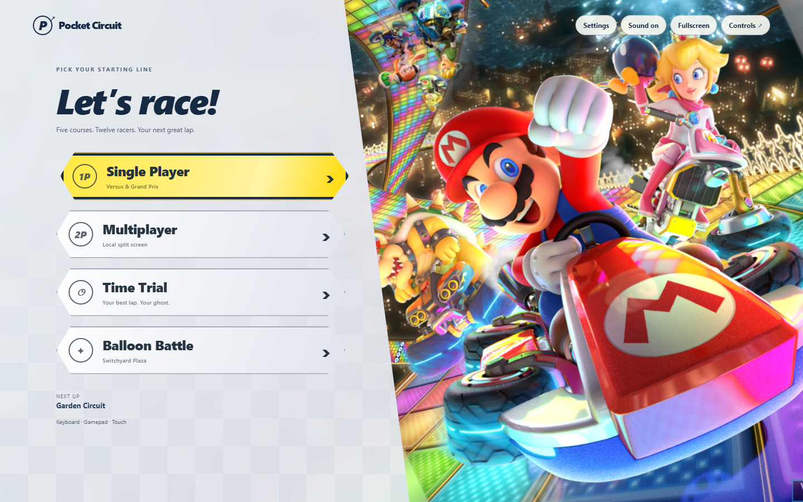
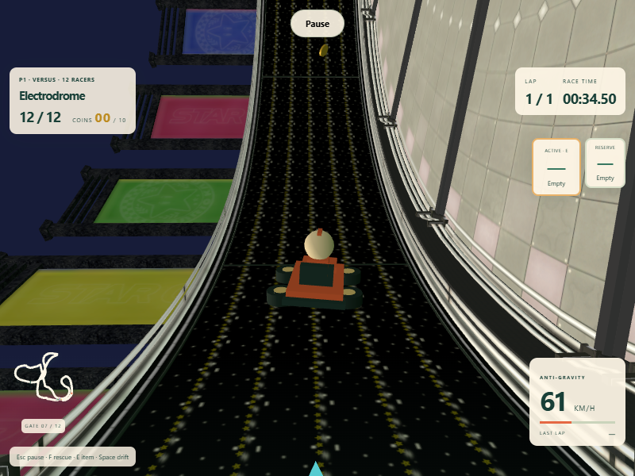

# Home screen and game bug audit — 18 October 2026

## Home screen

The supplied `51697-menu-Mario-Kart-8-Deluxe.jpg` is copied unchanged to `public/assets/menu/home-screen.jpg`. It supplies the background artwork; accessible HTML buttons provide Single Player, Multiplayer, Time Trial and Balloon Battle. These enter the supported local game modes rather than presenting nonfunctional online or wireless options. The layout adapts to desktop, phone portrait and phone landscape. The image honors Vite's deployment base path.

The covered 3D scene stops rendering while the title artwork is displayed. Setup and the garage retain their 3D previews. The menu preserves settings and links back to the existing controls, sound and display settings.

## Fixes

| Issue | Change | Regression coverage |
| --- | --- | --- |
| Camera smoothing could carry the camera through a wall even when the destination was safe | Constrain the rendered camera position immediately, using a small hull around the central ray; remove the old two-metre minimum that pushed through close obstacles | Distant and close-wall camera checks |
| Abrupt banked and inverted surface frames caused visual jolts | Ease the camera and kart visual orientations with quaternions; keep camera collision casts anchored above the actual contact surface | Inverted-camera and kart-orientation checks |
| Heading interpolation spun across the ±180° boundary | Interpolate along the shortest angular arc | Bidirectional seam checks |
| Banked kart collisions used horizontal-only separation and left karts off their magnetic road until the next simulation step | Resolve imported-course contacts in three dimensions and restore surface constraints within the same step; coincident karts separate along the road | Vertical contacts, coincident respawns and full imported races |
| Coplanar road markings and transparent lighting competed for depth | Offset imported road decals; disable depth writes on transparent effects; improve camera depth precision | Production Electrodrome race plus visual inspection |
| R or Escape in paused settings could restart or resume the race | Suppress shared race shortcuts while settings are open | Keyboard and browser settings checks |
| Accepted Control-key bindings did not work during play | Recognize an explicitly bound Control key and suppress browser shortcuts for active driving keys | Control + accelerate/steer/brake checks |
| Sound toggle needed two clicks after master volume reached zero | Toggle the displayed audible state and restore the normal master level when enabling sound | Browser zero-volume recovery check |
| Disconnecting P1's gamepad could move P2's controller assignment to P1 | Preserve connected assignments and ignore inactive player slots | Independent gamepad checks and disconnect browser flow |
| Cancelling a key remap could leave “Press a key…” visible or a capture listener active after navigation | Restore the binding label and release capture when leaving settings | Browser remap cancellation and return-to-race check |
| Damaged ghost frames could throw during loading | Reject malformed frame values before reading their properties | Null, primitive, array and negative-time ghost checks |

## Verification

- `npm run build`: passed with zero errors. The final JavaScript application chunk is `index-D_7hmF_-.js`; application HTML/CSS/JavaScript totals approximately 244 kB gzip, plus the supplied 763 kB JPEG. The GLB still loads separately.
- `npm test`: 64 passed, zero failures. This includes the four-course physical Grand Prix, all five courses, normal/mirrored magnetic driving, twelve-racer results, all eight items, battle scoring, ghosts, save validation, camera constraints and input isolation. The updated Control-key case also passed its targeted rerun.
- `npx playwright test`: all 10 production-browser cases passed. They cover Balloon Battle (solo and split), a complete Electrodrome race and mirrored split restart, failed-model recovery, menus/vehicle/settings persistence, a three-lap Time Trial with a saved/reloaded ghost, the complete four-race Grand Prix with reload/resume and podium, responsive home modes, independent two-player Versus finishes, storage/audio denial, combined touch inputs, graphics-context loss and gamepad disconnect/reassignment. The complete suite took 30.8 minutes in this software-rendered run.
- Final targeted Electrodrome rerun: passed against the camera/collision bundle, including actual keyboard driving, inverted banking, gliding, results, shared pause and a single shared model download. Screenshots were refreshed from this run.
- Final targeted home audit: passed after the last input/audio changes. It checks 1440 × 900, 390 × 844 and 844 × 390 layouts; all four mode shortcuts; zero-master-volume recovery in one sound-button click; paused-settings shortcuts; cancelled remapping; and accelerating/steering together with a remapped Control key.

Browser checks use Chromium with SwiftShader and an accelerated simulation clock. This verifies functional flows rather than hardware frame-rate targets. Physical gamepads, hardware GPUs, Safari and Firefox remain outside this local run.

The Electrodrome model remains a playable adaptation: the primary route includes a visible magnetic return connector, and the alternative branch is scenery. Normal rescue and DNF rules still apply. The audit does not claim that every possible device, race seed or input sequence is defect-free.

## Visual checks

The desktop, portrait and landscape home captures were inspected for readable buttons and clipping. The imported-course capture shows the kart and camera following an inverted magnetic section.

[Phone portrait](screenshots/home-mobile-audit.png) · [Phone landscape](screenshots/home-landscape-audit.png)

