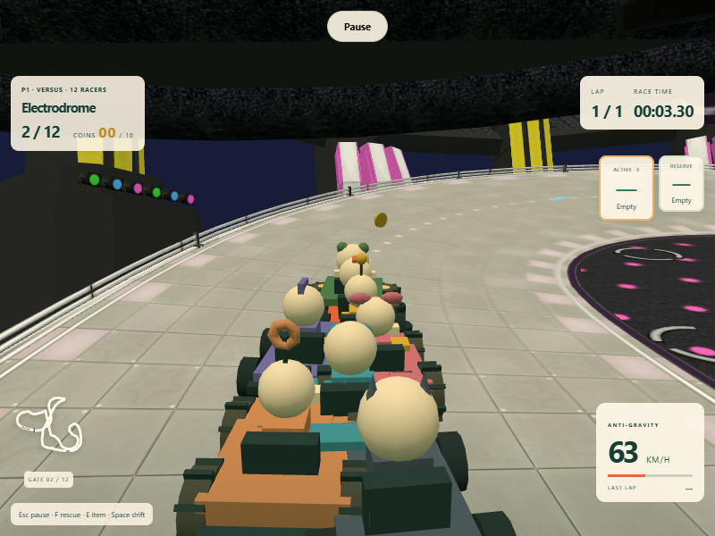
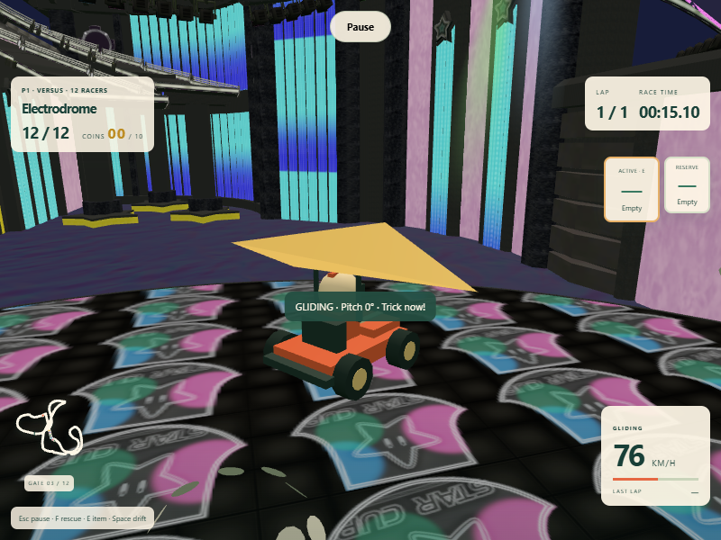
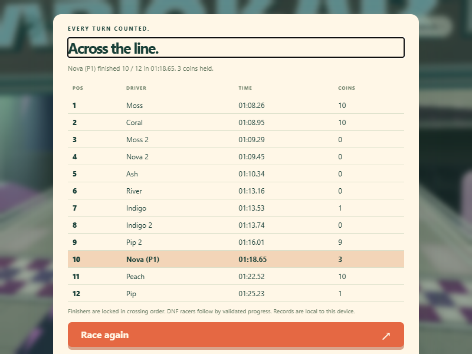

# Electrodrome integration

The supplied `mario_kart_8_-_electrodrome.glb` is retained byte-for-byte as `public/assets/tracks/electrodrome.glb`. Its author, source, license metadata and SHA-256 are recorded in [the asset credits](../public/assets/tracks/README.md), with attribution also available in course setup.

## Playable adaptation

Electrodrome is a fifth selectable course in Versus and Time Trial. The existing four-course Grand Prix roster is independent of bonus courses, preserving existing saved cups. The entire model and gameplay route reflect for mirrored play. One- and two-player races retain twelve competitors.

The GLB supplies visual geometry, not race rules or navigation. `scripts/import-electrodrome.mjs` extracts selected road geometry and produces the authored navigation ribbon in `src/tracks/electrodrome-data.json`. The approximately 1,057 m primary circuit includes the starting curve, a glider flight, the lower loop and elevated magnetic roads. The alternative colored branch remains scenery; cyan route markers indicate the playable primary circuit. A visible magnetic return connector replaces the narrow exported rail junction with a smooth driving transition. This is a playable adaptation, not a claim to reproduce Nintendo's original collision or race data.

The route has twelve ordered 3D checkpoint planes, collision widths, twelve safe grid poses, rescue positions, item/coin placement and AI guidance. Crossing lookup uses position, height and recent progress so overlapping road layers cannot pull a kart onto a different section. Checkpoints avoid the glider launch and landing margin. Driving, steering, camera orientation, ghost recording and projectile movement use full surface frames for vertical and inverted sections. Ordinary driving still requires steering; AI uses the same controllers, items, collisions and rescue penalties as humans.

The authored glider launch supplies a forward impulse. Pitch and yaw remain controllable in flight. Failed flights use ordinary rescue, with validated gate/lap progress preserved. Camera terrain clamping remains enabled for procedural courses and uses the magnetic frame for this course. Road and major wall meshes participate in camera obstruction checks.

## Loading and resources

The 15.5 MB GLB downloads only when the course is selected. Textures are embedded; no external media service is required. The URL honors `import.meta.env.BASE_URL` and works under the repository's GitHub Pages subpath. Loading reports download/material preparation, and failure offers retry or return to a different course. One decoded asset is shared across restarts, mirrored versions and quality changes; course clones do not dispose its shared resources. Low quality hides distant city meshes. The application releases cached model resources on teardown.

## Executed checks

- `npm run build`: passed with zero errors.
- `npm test`: 58 passed, including the existing battle and four-course release checks.
- Normal and mirrored imported-course simulations each drove a complete valid lap, including gliding and inverted driving, with no rescue.
- A twelve-controller race accepted all twelve finishes in 93 simulated seconds. Some drivers used two recoveries during traffic; the full field finished.
- Targeted simulation checks validate asset size/header, course selection/save validation, cup roster separation, grid/collision frames, ordered checkpoints, finite geometry, magnetic projectile hits and full-orientation ghosts.
- Production Chromium drove a full one-lap race using real keyboard input, observed magnetic/inverted/gliding states, and reached results with twelve rows. It then restarted as a mirrored two-player race and checked shared pause. The GLB was requested once across these course swaps; no page or console errors were observed.
- A separate production check returned a failed model request, verified retry, returned to a procedural course and started it successfully.

Browser verification uses software SwiftShader at 800 × 600 / low quality with an accelerated simulation clock. It proves functional game flow, not hardware frame-rate targets. Hardware GPU, physical controller and additional browser/device performance remain unmeasured.

