# Milestone Three verification

This record distinguishes executed checks from hardware/browser targets that remain unmeasured. All screenshots below come from the actual local production preview under `/mariokart-browser-game/`.

## Environment

- Windows x64; Node 24.19.0; Intel Core i7-1185G7, eight logical CPUs.
- Playwright Chromium, software SwiftShader; low quality for long race checks, 800 × 600 viewport. Menu captures use 1440 × 900; split captures use 960 × 640.
- Fixed 60 Hz simulation; browser clock advances through real controls without writable race-state hooks. Compact release courses shorten full mode runs; separate simulation checks drive the full-size routes.
- Grand Prix completion uses a 640 × 480 viewport and a bounded 30-minute software-rendering timeout. An earlier 15-minute run reached the fourth course before timing out; it is not counted as a completed browser run.
- The desktop 1080p/60 fps and physical mobile 30 fps acceptance targets have not been measured on hardware rendering. Do not infer them from accelerated-clock checks.

## Executed simulation checks

`npm test` passed **44 tests**. `npm run build` passed with zero errors after the final physics, batching and resilience changes. This includes:

- Physical twelve-racer laps on all four full-size courses; water, anti-gravity and glider states were observed. Every racer completed those route checks without rescue.
- A complete four-course, three-lap Grand Prix, using physical controllers, shared items and checkpoints. Save/reload between each course, points totals, duplicate-result protection, final completion, new cup and abandonment passed.
- All eight item systems: eligible weighted draws, restricted opening items, trap arming/owner grace, bouncing projectile collision, boosts, homing turn limit/warning, explosive single-hit radius, shield clearing/counter and timed invincibility.
- Versioned save migration, malformed/denied data, mode normalization and cross-player key validation; versioned ghost sampling/interpolation and memory fallback.
- All 144 vehicle combinations, mirrored course geometry/local frames, pitch/yaw flight, independent human inputs, remapped keyboard aliases, multi-touch state, two gamepads and disconnect detection.
- Ordered checkpoints, shortcut/backward rejection, rescue, wrong-way warning, fixed-step behavior at 30/60/120 render rates, drift stages, ranking, same-step finish order, DNF timeout and clean restart.

The integrated default Garden Circuit race took 148.2 simulated seconds with items and no rescue. Some opponents correctly received DNF after the fifteen-second results timeout. The one-lap full-course route tests completed their fields in 51.0 s (Garden), 61.3 s (Harbour), 57.7 s (Sky) and 58.3 s (Starlight). These are seeded simulation measurements, not real-world frame-rate measurements.

## Executed production checks

- Menu/vehicle/settings/split smoke check passed: four course cards, eight driver choices, physical part selection, garage preview, two humans plus ten AI, countdown locking, independent rear view, shared pause, stacked layout, resize, restart, one canvas and persisted quality/layout/mute after refresh.
- Time Trial passed: one racer, no random boxes, exactly three boosts, three valid keyboard-driven laps, one result, saved local best/IndexedDB ghost and restart. No page/console/request errors were observed.
- Grand Prix passed a complete four-course, three-lap keyboard-driven cup in 13.0 minutes of software-rendered browser verification. The run refreshed and resumed after race one, checked twelve results and cumulative points after every race, and verified the final title and three podium entries. All four human course runs completed without rescue.
- Two-player Versus passed a full one-lap shared race: both independent keyboard drivers finished, all twelve results were accepted, and the partial-finish phase remained playable.
- Storage and audio denial remained playable. Browser-generated simultaneous touch inputs accelerated and steered; shared touch pause/resume worked. A lost WebGL context paused and displayed explicit reload guidance with a reload button.
- A mocked gamepad drove the kart, disconnect paused the shared race with a prompt, and reassignment to keyboard resumed successfully.
- `npm run test:browser`: **6 passed**, 16.9 minutes total. The complete Grand Prix is intentionally given a longer bounded timeout for software rendering.

## Captures

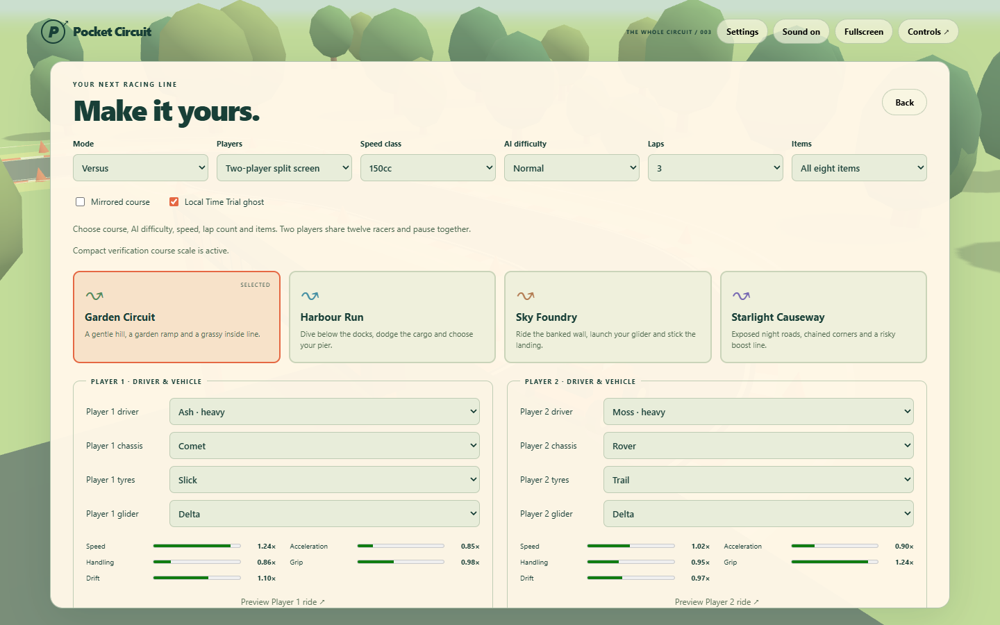
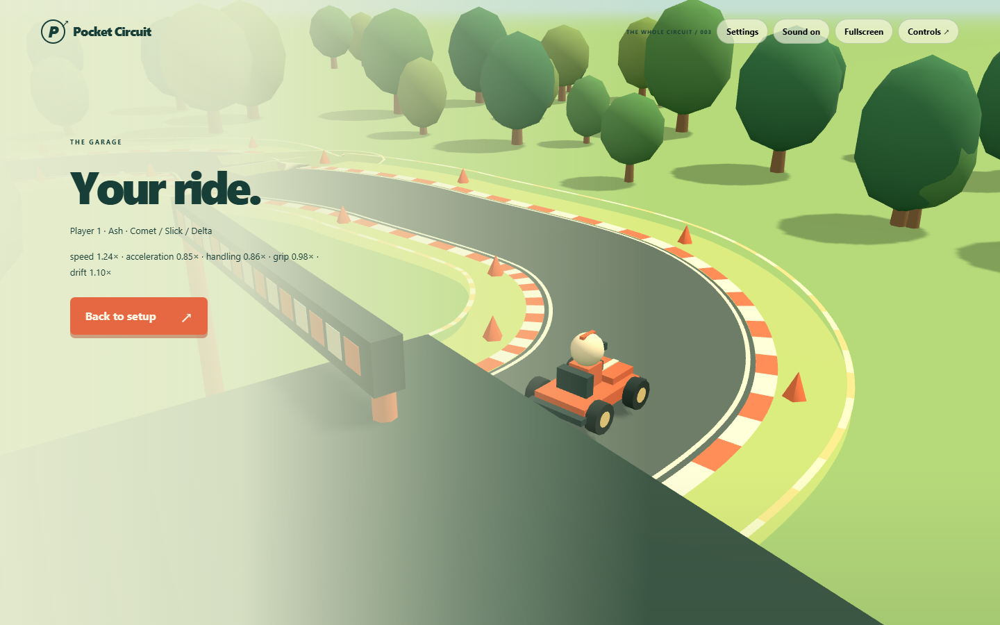
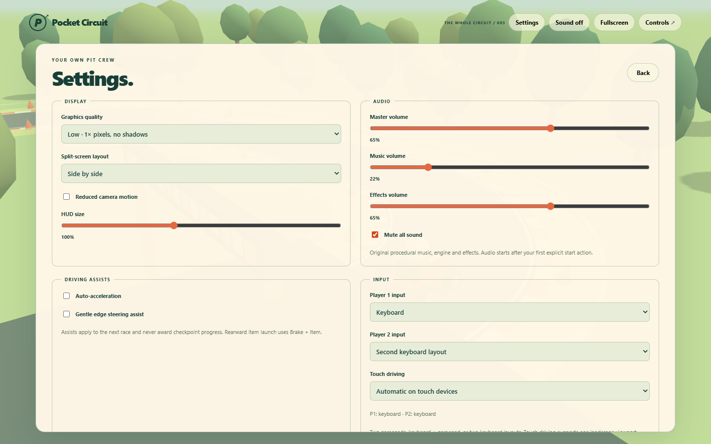
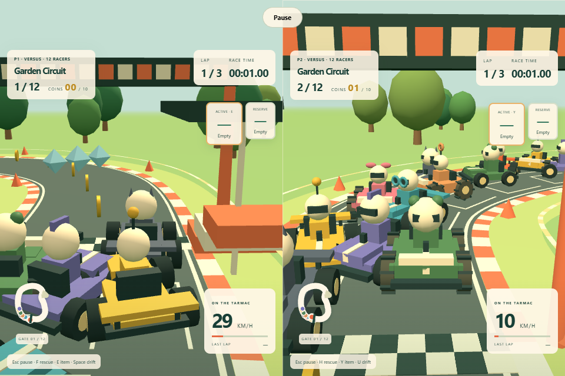
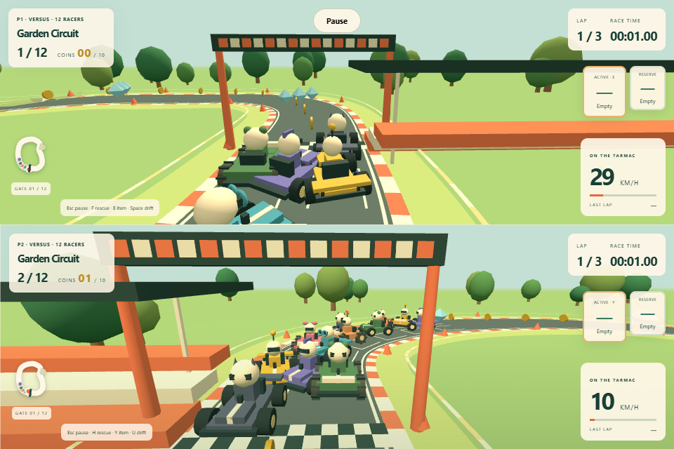
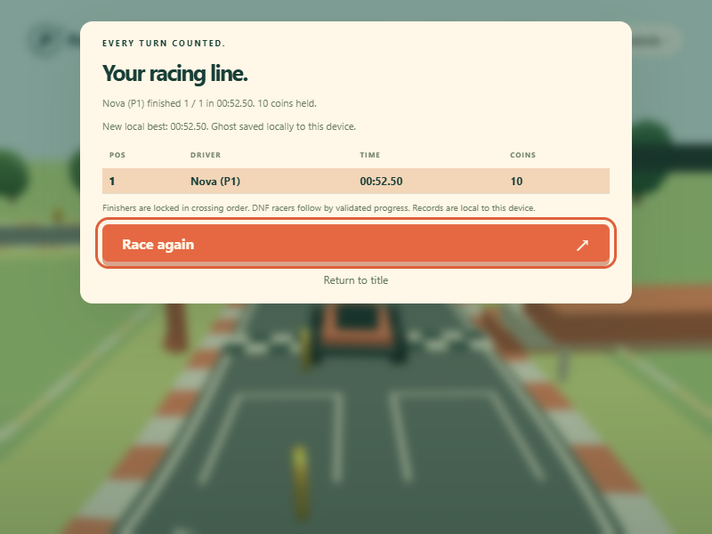
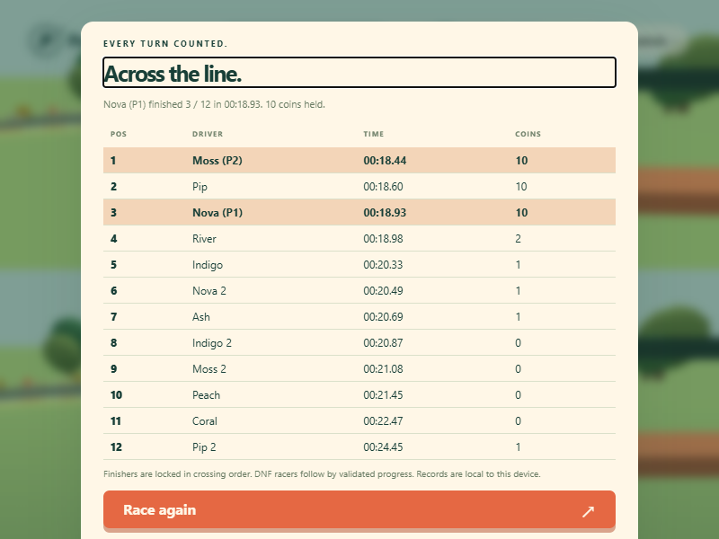
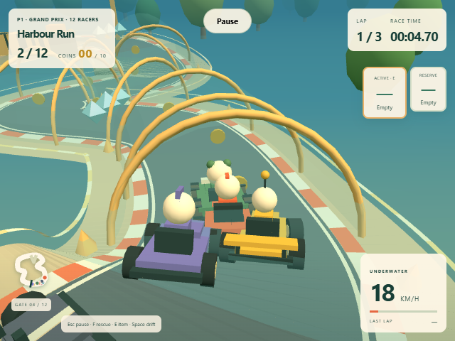
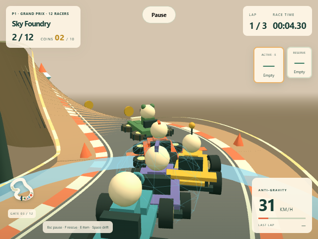
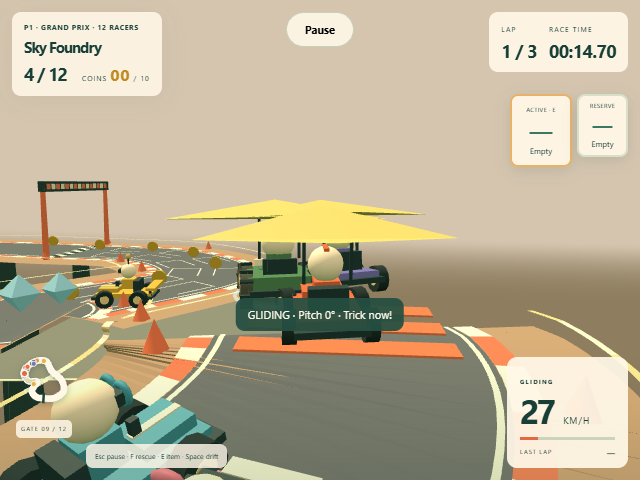
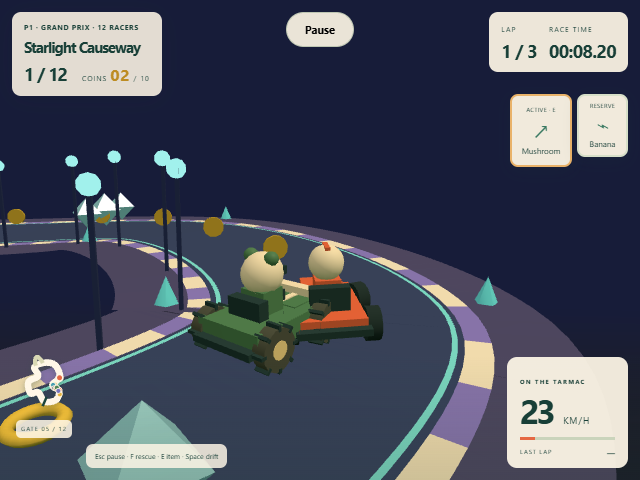

## Limits and handover

Rendering uses original procedural geometry and audio. Static kart geometry is batched by material, while separate wheel assemblies retain rolling, steering and anti-gravity rotation. Quality changes do not change collision, checkpoints, items or scoring. Repeated race swaps reuse render pools and dispose replaced course/model geometry and materials.

The current compressed HTML/CSS/JS transfer is about 187 kB gzip, far below the 15 MB initial target; there are no external asset requests. Actual controller hardware, phone ergonomics, Firefox/Safari/Edge, screen readers and hardware GPU frame-rate targets remain unmeasured. Gamepad adapter checks use browser input mocks; touch uses browser-generated multi-touch events. Context-loss handling provides a reload explanation rather than automatic restoration.

Milestones One and Two were previously published. Milestone Three passed the local checks above. Publishing uses the configured GitHub Actions workflow; verify deployment status and the published URL against the corresponding workflow run.
