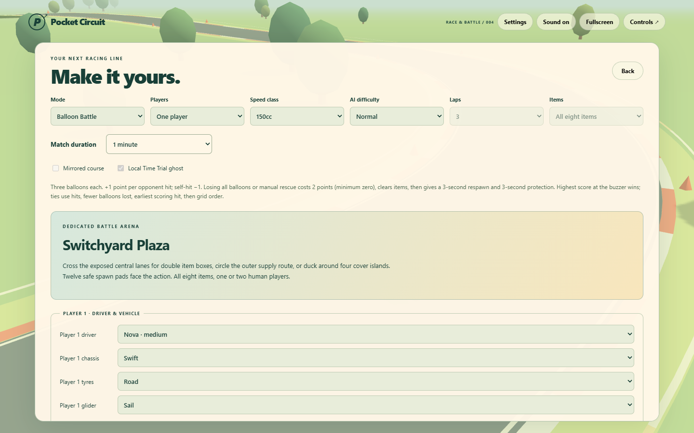
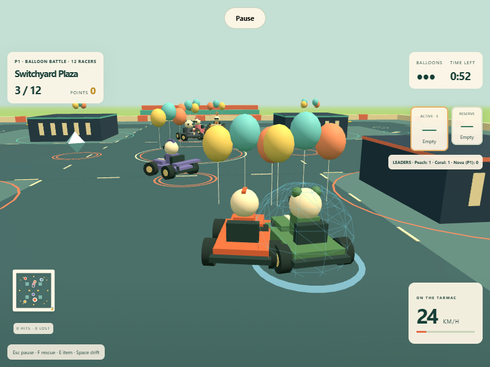
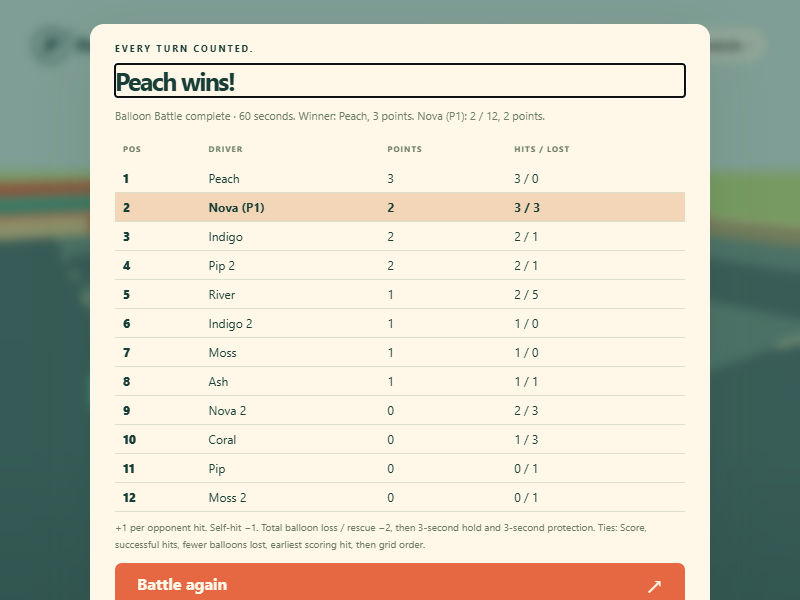
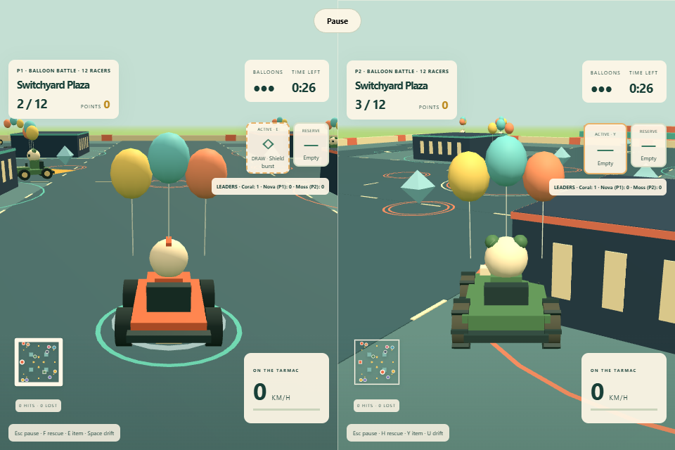

# Milestone Four · Balloon Battle

Implements the Milestone Four paragraph on page 9 of Specification.md. The existing four-course release remains available. Balloon Battle is the only expanded battle rule set exposed.

## Arena and navigation

Switchyard Plaza is a compact 88 × 88 m open arena. Four 8 × 8 m, 2.8 m tall cover islands create several intersecting approaches. Four exposed central double boxes and twelve outer single boxes create distinct supply choices. Twelve inward-facing pads are more than ten metres apart, outside expanded cover collision and within the walls. Rendering, camera blockers, kart collision and projectile collision use the same arena data. The arena minimap shows cover and supplies rather than a finish line.

ArenaDriver chooses available supplies when empty and moving opponents when armed. It predicts opponent positions, routes through a cached visibility graph around inflated cover corners, and avoids nearby spatial threats and karts. It never follows checkpoints. Seeded difficulty traits affect pace and reaction; all drivers use shared physics, item draws, inventory, hit immunity and recovery penalties. A stuck driver reverses before requesting rescue. Respawn clears the driver's recovery state.

## Rules and interface

- Twelve racers, one or two humans. Three 3D balloons per kart, with a matching per-human HUD count, visible at low quality. Pop removes one balloon.
- Opponent hit: +1 point. Self-hit: −1. Scores floor at zero. Shield, invincibility, owner grace and brief hit immunity apply before any score is awarded. One explosion hits each racer at most once. Cover stops ordinary projectiles and shields explosions; leader strikes travel overhead.
- Total balloon loss or manual rescue: −2 points, empty inventory and three-second hold. Select the safest pad against current active racers/items at the end of the hold; restore three balloons and three seconds of protection. The camera snaps to a distant respawn. No checkpoint, lap or coin rewards exist in battle.
- 30/60/120/180-second matches, default 120. Countdown locks movement; pause freezes the timer, physics and respawn holds. At zero, results freeze and name one winner. Ties use successful hits, fewer balloons lost, earliest successful scoring hit, then grid order.
- Setup documents the arena and rules. HUD shows timer, points, live leaders, balloons, hit feedback and respawn countdown. Results show points, hits/losses, winner and tie-break rules. Restart restores the selected duration, zero scores and three balloons. Mode/duration persist locally; battle does not advance a cup or write Time Trial records.

## Verification

Executed locally on Windows, Node 24.19.0. Browser checks use Playwright Chromium with software SwiftShader and the actual Vite production output, primarily at 800 × 600 / low quality; split screen uses 960 × 640. No writable simulation hooks are exposed. The test driver reads telemetry and presses real keyboard keys through the public input path.

The battle simulation checks cover safe geometry, cover navigation, physical item hits and scoring ownership, self-hits, shields/immunity, explosive single-hit behavior, total-loss penalty, inventory clearing, protected respawn, shared pause, timer completion, deterministic ties, frozen results, settings/session isolation, three visible balloon pools at low quality, and pickup pools across mode changes. A complete seeded two-minute match recorded 129 pickups, 25 hits and use of all eight items; all eleven AI explored multiple arena sectors, with balloon losses, respawns and a positive-score winner. Existing full-course and four-race Grand Prix checks remain in the suite.

`npm run build` passed with zero errors. The simulation suite passed 53 checks (44 existing plus nine battle checks). The production browser check plays a full 60-second human battle through keyboard pickup/item controls and observes opponent hits and balloon loss. It checks frozen results and winner, restart, saved mode/duration after reload, then a complete 30-second two-player match with independent movement, manual rescue, three-second replenishment/protection and shared pause. It returns to Versus and checks the racing course selector. It fails on page, console or request errors.

Hardware frame-rate targets and additional browser/device coverage remain unmeasured, as recorded for Milestone Three. These accelerated-clock software-rendering checks verify gameplay and mode flow, not hardware performance.
